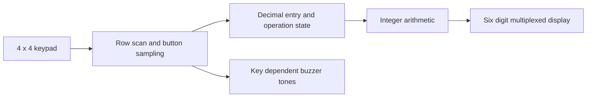
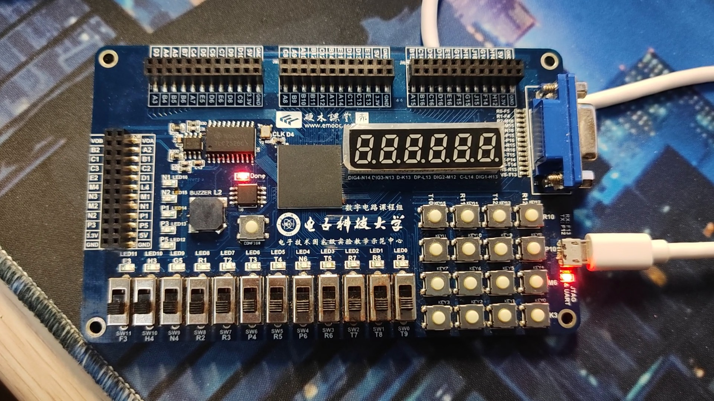

# FPGA Calculator

Verilog 课程工程：矩阵键盘、整数运算、数码管与蜂鸣器，以及独立的串行显示和浮点实验。

**简体中文** · [English](README_EN.md) · [日本語](README_JA.md)

**深入阅读：** [技术说明](docs/technical-notes.zh-CN.md) · [部署与操作](docs/setup.zh-CN.md)

项目的主要实现是按键输入驱动的整数计算器。仓库同时保存两个探索版本；它们存在明确的集成缺口，不能把三个目录拼成一个已经完成的浮点计算系统。文档以 Vivado 源文件集和实际模块连接为依据。

## 项目与版本范围

| 目录 | 源码内容 | 当前边界 |
| --- | --- | --- |
| `integer_calculator_buzzer` | 输入状态、加减乘除、六位显示、按键音 | 主要课程实现；边界条件和复位仍需验证 |
| `integer_calculator_74hc595` | 消抖、移位加法乘法、移位减法除法、Double Dabble、串行驱动模块 | 顶层连接不完整，不能直接宣称可运行 |
| `float_calculator_ieee754` | 浮点格式与 ALU 状态机实验 | 输入转换、除法和顶层连接未完成，不是完整 IEEE 754 FPU |

两个 `.xpr` 均选择 `xc7a35tftg256-1`。工程没有可核验的当前利用率或时序报告，不保留资源占用、最高频率等旧指标。

## 主要实现链路



主版本只有 `caculator.v` 被列入 RTL 源文件集，顶层名为 `Caculator`。同文件包含分频、扫描、计算、显示和蜂鸣器模块；其他目录的算法不属于这条执行链。

## 值得阅读的工程内容

- 4×4 行列键盘扫描、低频按钮采样、数字/运算符输入状态与清除。
- 两位十进制操作数输入、结果显示和除法小数位尝试；`sw1`/`sw2` 参与相同数字的重复输入。
- 六位数码管复用与按键相关频率的蜂鸣器音调。
- 独立实验中的算术握手、BCD 转换和串行移位设计，连同其尚未完成的连接。

[实现与已知问题](docs/technical-notes.zh-CN.md#baseline) 给出模块职责、算术边界和时钟计算，不将代码存在等同于实测通过。

## 实物资料



保留课程演示截图作为历史实物资料；截图本身不能证明当前三个源码版本均已烧录或通过测试。

## 工程与使用

```text
integer_calculator_buzzer/
  project_3.xpr
  project_3.srcs/sources_1/new/caculator.v
  project_3.srcs/constrs_1/new/Con_Caculator.xdc
integer_calculator_74hc595/
  src/   # top, keypad, arithmetic, BCD, display and shift driver
  sim/
float_calculator_ieee754/
  cacu.xpr
  cacu.srcs/sources_1/new/
docs/
  images/
  technical-notes.*.md
  setup.*.md
```

先阅读[打开工程与验证步骤](docs/setup.zh-CN.md)。主要工程保存版本为 Vivado 2024.1.2，浮点工程为 2024.1；这不是所有工具版本均兼容的保证。

## 验证、贡献与后续

本次完成静态 RTL、工程 XML、约束和历史仿真记录核查，没有执行 HDL 编译、仿真、综合、时序收敛或板上测试。当前环境未找到可用的 Vivado/Icarus/Verilator 工具。

优先补全复位与时钟约束、算术边界测试，再分别修复两个实验版本。旧项目资料列出刘超然、李帆章；现有代码不足以独立划分每个人的模块贡献。代码许可见 [LICENSE](LICENSE)，外部资料的来源与权利应单独核对。
