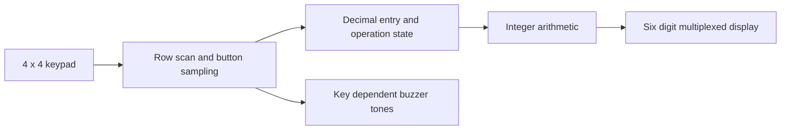

# FPGA Calculator

A Verilog course project covering keypad input, integer arithmetic, multiplexed display, and key tones, with separate serial-display and floating-point experiments.

[简体中文](README.md) · **English** · [日本語](README_JA.md)

**Explore：** [Technical notes](docs/technical-notes.en.md) · [Setup and operation](docs/setup.en.md)

The main implementation is an integer calculator driven by keypad input. Two exploratory variants are also archived. Their integration gaps are documented separately; combining their modules would describe a system that the repository does not currently implement. Vivado file sets and actual connections define the scope.

## Project variants

| Directory | Source content | Status |
| --- | --- | --- |
| `integer_calculator_buzzer` | Entry states, four arithmetic operations, six-digit display, key tones | Main course implementation; reset and arithmetic boundaries need validation |
| `integer_calculator_74hc595` | Debouncing, shift-add multiplication, shift-subtract division, Double Dabble, serial driver | Incomplete top-level integration |
| `float_calculator_ieee754` | Floating-point format and ALU state-machine experiments | Unfinished conversion, division, and wiring; not a complete IEEE 754 FPU |

Both `.xpr` files target `xc7a35tftg256-1`. No current utilization or timing report supports the former resource or maximum-frequency claims.

## Main implementation



The main RTL file set contains only `caculator.v`, with top module `Caculator`. It includes clock division, scanning, calculation, display, and buzzer modules. Algorithms in other directories are separate experiments.

## Engineering content

- 4×4 row/column scanning, low-rate button sampling, decimal/operator entry states, and clear.
- Two-digit operand entry, result display, and an attempt at fractional division display; `sw1`/`sw2` participate in repeated identical-digit entry.
- Six-digit multiplexing and key-dependent buzzer tones.
- Separate arithmetic handshakes, BCD conversion, and serial shifting experiments, including their missing connections.

[Implementation notes](docs/technical-notes.en.md#baseline) explain module roles, arithmetic limits, and clock calculations. Source presence is distinguished from measured operation.

## Hardware material


The course screenshot preserves the physical demonstration context. It does not establish that all three current source variants have been programmed and tested.

## Repository and use

```text
integer_calculator_buzzer/
  project_3.xpr
  project_3.srcs/sources_1/new/caculator.v
  project_3.srcs/constrs_1/new/Con_Caculator.xdc
integer_calculator_74hc595/
  src/   # top, keypad, arithmetic, BCD, display and shift driver
  sim/
float_calculator_ieee754/
  cacu.xpr
  cacu.srcs/sources_1/new/
docs/
  images/
  technical-notes.*.md
  setup.*.md
```

Read the [project and validation guide](docs/setup.en.md) first. The main project records Vivado 2024.1.2; the floating-point project records 2024.1. These are saved project versions, not a guarantee of compatibility with every tool release.

## Verification and credits

This review inspected RTL, project XML, constraints, and historical simulation records. No HDL compilation, simulation, synthesis, timing closure, or board test was performed; no usable Vivado, Icarus, or Verilator executable was found in this environment.

Reset, clock constraints, and arithmetic boundary tests take priority over completing the two experiments. Earlier project material lists Chaoran Liu and Fanzhang Li; source alone does not establish their individual module ownership. See [LICENSE](LICENSE); external material requires separate provenance and rights checks.
