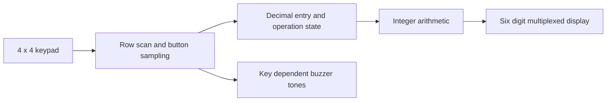

# FPGA Calculator

行列キーパッド、整数演算、時分割表示、キー音を扱う Verilog 演習と、独立したシリアル表示・浮動小数点の実験。

[简体中文](README.md) · [English](README_EN.md) · **日本語**

**詳細：** [技術ノート](docs/technical-notes.ja.md) · [導入と操作](docs/setup.ja.md)

主な実装は、キー入力で操作する整数計算器です。別の二つの実験版も保存していますが、接続や演算には未完成部分があります。三つのディレクトリの機能を、一つの完成済みシステムとして扱いません。Vivado のファイルセットと実際の接続を基準に説明します。

## プロジェクトと実装範囲

| ディレクトリ | ソースの内容 | 状態 |
| --- | --- | --- |
| `integer_calculator_buzzer` | 入力状態、四則演算、6桁表示、キー音 | 主な演習実装。リセットと演算の境界条件は要検証 |
| `integer_calculator_74hc595` | チャタリング除去、シフト加算乗算、シフト減算除算、Double Dabble、シリアル駆動 | トップレベルの統合が未完成 |
| `float_calculator_ieee754` | 浮動小数点形式と ALU 状態機械の実験 | 変換・除算・接続が未完成。完全な IEEE 754 FPU ではない |

両 `.xpr` の対象デバイスは `xc7a35tftg256-1` です。現行ソースに対応する使用率・タイミングレポートがなく、従来のリソース量や最高周波数は掲載していません。

## 主な処理経路



主工程の RTL ファイルセットに含まれるのは `caculator.v` のみで、トップは `Caculator` です。同じファイルに分周、走査、演算、表示、ブザーの各モジュールがあります。他ディレクトリのアルゴリズムは独立した実験です。

## 技術的な見どころ

- 4×4行列走査、低周期のボタンサンプリング、数字・演算子入力の状態管理とクリア。
- 2桁の被演算数入力、結果表示、除算の小数表示の試行。同じ数字の再入力には `sw1`/`sw2` も関与します。
- 6桁の時分割表示と、キーごとのブザー音。
- 独立実験における演算ハンドシェイク、BCD変換、シリアルシフト、および未接続部分。

[技術ノート](docs/technical-notes.ja.md#baseline) にモジュールの役割、演算の制約、クロック式を記載しています。コードの存在と実測結果を区別します。

## 実機資料


演習時の実物資料として保存した画像です。現在の三つのソース版すべての書き込み・動作確認を証明するものではありません。

## 構成と利用

```text
integer_calculator_buzzer/
  project_3.xpr
  project_3.srcs/sources_1/new/caculator.v
  project_3.srcs/constrs_1/new/Con_Caculator.xdc
integer_calculator_74hc595/
  src/   # top, keypad, arithmetic, BCD, display and shift driver
  sim/
float_calculator_ieee754/
  cacu.xpr
  cacu.srcs/sources_1/new/
docs/
  images/
  technical-notes.*.md
  setup.*.md
```

[工程の開き方と検証手順](docs/setup.ja.md) を先に確認してください。主工程の保存バージョンは Vivado 2024.1.2、浮動小数点工程は 2024.1 です。すべてのツール版での互換性を保証する情報ではありません。

## 検証・担当・今後

Icarus Verilog 13.0で実RTLをコンパイル・実行し、a=0–99、b=1–99の商・余り9900組、98/99の小数2桁、ゼロ除算、混合連続演算、負の減算、クリア、初期化・分周・ブザー境界が通過しました。calのキー配列を直接駆動し、分周端点は既知カウントを与えた検査で、物理キー・音程・周波数の測定ではありません。Vivado合成・実装・タイミング収束・再書込は未実施です。

リセット、クロック制約、演算境界テストを優先し、二つの実験版は個別に修正する必要があります。過去の資料には劉超然・李帆章の名前がありますが、ソースだけでは担当モジュールを特定できません。[LICENSE](LICENSE) と、外部資料の出典・権利を別途確認してください。

## 保守修正とRTL自己検査

2026-10の主ブザー版は余りを7ビットへ拡大し、ゼロ除算・剰余をガードし、結果後の新演算子をopへ反映します。演算状態、走査数、分周出力、ブザーカウントを明示初期化し、クリアで結果・余りを戻します。分周半周期の端点を修正し、周波数0は無効、キーなしの起動時は音を要求しません。

Icarus Verilog 13.0で実RTLをコンパイル・実行し、a=0–99、b=1–99の商・余り9900組、98/99の小数2桁、ゼロ除算、混合連続演算、負の減算、クリア、初期化・分周・ブザー境界が通過しました。calのキー配列を直接駆動し、分周端点は既知カウントを与えた検査で、物理キー・音程・周波数の測定ではありません。Vivado合成・実装・タイミング収束・再書込は未実施です。
