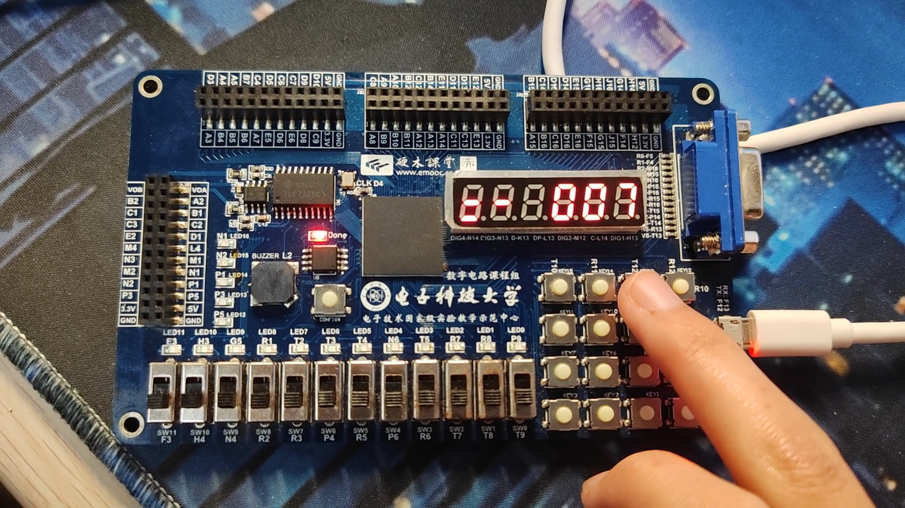
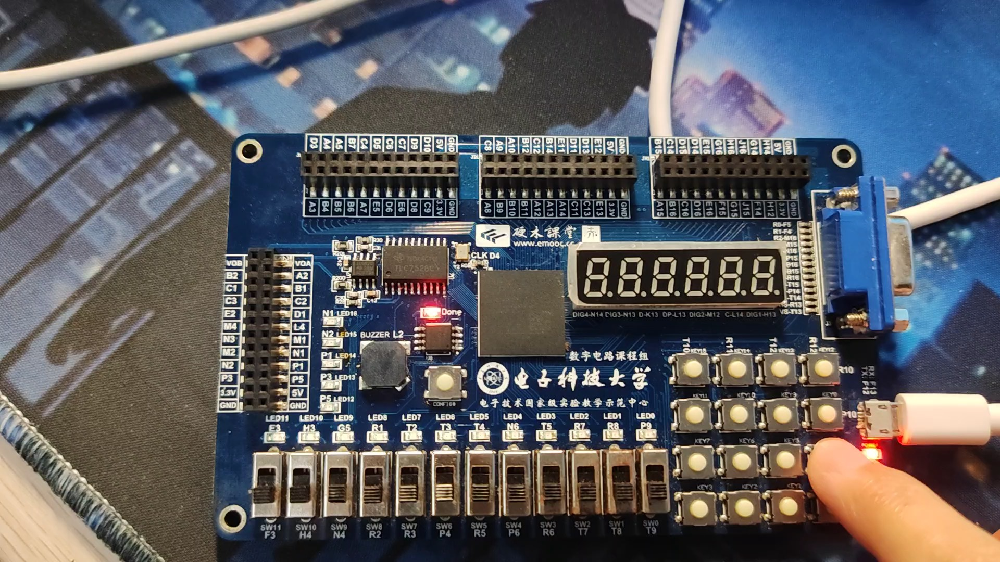

# FPGA Calculator — 技术说明

**简体中文** · [English](technical-notes.en.md) · [日本語](technical-notes.ja.md) · [项目首页](../README.md)

<a id="baseline"></a>

## 主版本：从输入到显示

[caculator.v](../integer_calculator_buzzer/project_3.srcs/sources_1/new/caculator.v) 包含 `Caculator`、`cal`、`FreDiv`、`button`、`buzzermusic`、`Buzzercontrol`。`cal` 将键值 0–9 用于数字，10–13 用于加减乘除，14 为等号、15 为清除。数字输入按两位组织；状态与按键保持判断共同决定接收，重复数字还受两个开关控制。

`a_reg` 为 21 位，`b_reg` 为 7 位，结果寄存器为 21 位。负结果用幅值和标志显示，不应描述成完整有符号数运算。显示按计数器 0–5 刷新六位，6、7 为空槽；不是每位都以 1 kHz 完整刷新。部分时钟、扫描计数器和蜂鸣器寄存器无确定初始化/复位，仿真可能保持未知值。

代码保存了连续运算分支，但结果状态下选择另一运算符并非总会更新 `op`，混合连续运算需要独立测试。不能只因存在状态分支就宣称支持所有表达式。

<a id="timing"></a>

## 时钟、采样与按键音

```math
f_{out}\approx\frac{f_{clk}}{2(\lfloor25000000/f_{req}\rfloor+1)}
```

```math
(b_2\land b_1\land b_0)\lor(\neg b_2\land b_1\land b_0)=b_1\land b_0
```

`FreDiv` 的常数是 25,000,000，计数达到整除商时翻转输出。上式是在输入时钟已知时的代码推算；50 MHz 输入下请求值 1000/50 对应近似 1 kHz/50 Hz，不代表板上测量。主版本在扫描时钟正/负沿分工，又以低频按钮采样形成跨时钟路径，未证明同步与时序约束充分。

按钮三寄存器表达式化简为上面的 `b1 & b0`，不能宣传“三次连续一致”或精确 20 ms 端到端消抖。它与 74HC595 目录的计时状态机不是同一实现。

`buzzermusic` 按键选择固定计数表，`Buzzercontrol` 生成方波音调；这不是运算完成后的独立乐曲播放器。实际音高依赖输入时钟与计数端点。

<a id="arithmetic"></a>

## 算术与显示边界

- `result <= a / b` 和 `%` 在计算处没有零除保护；显示中的零除提示不等于阻止运算。
- 余数 `res` 只有 4 位，大于 15 的余数会被截断；后续两位小数也可能错误。不能承诺任意两位除数下小数准确。
- 结果路径与数码管可显示范围不同，没有完整溢出保护；小数显示尝试不是浮点运算。
- [multiplication.v](../integer_calculator_buzzer/project_3.srcs/sources_1/new/multiplication.v) 不在主工程活动源文件集。其变量条件生成及对 `wire` 的裸赋值存在 RTL 语法/结构问题，不能当作已综合乘法器。
- 两个 `.xpr` 的 `sim_1` 没有列入独立测试文件。散落测试使用 `$display`/`$stop`，缺少结果断言；`sim1.v` 还引用缺失模块并包含非法负数写法。

<a id="experiments"></a>

## 两个探索版本的实际状态

| 模块 | 源码可确认内容 | 集成缺口 |
| --- | --- | --- |
| 74HC595 `key_scan` / `operation_ctrl` | 双寄存器同步、计数消抖、输入状态、加减和乘法握手 | 顶层乘法实例缺失，除法未接入 |
| `mult` / `div` | 独立移位加法乘法、移位减法除法；后者有零除分支 | 不能把其保护逻辑归到蜂鸣器主版本 |
| `hex2bcd` | 移位与各 BCD 位大于等于 5 加 3 | 默认 27 位输入对应 9 位十进制、36 位输出；顶层接收 32 位，显示又只取六位 |
| `seg_disp` / `hc595_drive` | 段码与 16 位移位/锁存设计片段 | 扫描控制缺失；驱动段输入只有 6 位；顶层 `ds/sclk/rclk` 未接驱动实例 |
| 浮点 `Top` / 输入与输出转换 | 两个输入解析实例、格式转换及显示实验 | 隐式标量网线、未驱动时钟/信号、两个转换器重复接第一个数据，输出位选未接通；活动 XDC 为空 |
| `ALU_float` | 八状态控制、阶码对齐、尾数加减乘及部分规格化/舍入 | 除法路径没有商计算；乘除符号用 OR 而非 XOR；零、非正规数、NaN/Inf 与舍入处理不完整 |

浮点输入解析用拼接/截断代替完整十进制浮点转换；`float_to_ieee754` 的整数减自身使小数部分为零，不能正确转换一般数值；输出也不是完整浮点到十进制算法。因此仅标记为未完成实验。

74HC595 `src/transcript` 保存 2024-01-23 的历史 ModelSim 记录，出现已实例化的乘除和移位驱动，以及位宽警告；这与当前 `top.v` 不一致。`src/test.v` 与 `sim/test.v` 也不是同一接口/刺激版本，后者仍使用当前顶层没有的显示端口。历史“Errors: 0”不能当作当前源码验证结果。

<a id="evidence"></a>

## 资料与版本边界

主版本 RTL 与本地 `Documents/Vivado/project_3` 同名文件逐字节相同；仓库浮点 `Top.v` 对应本地 `cacu (1)`，与 `cacu(2)` 不同，文档没有混合两者。





这些画面保留展示价值，但没有当前提交对应的自动测试报告、资源利用率或时序测量。资料中的板卡外观与器件约束应分别核验，不仅凭照片认定完整开发板规格。
